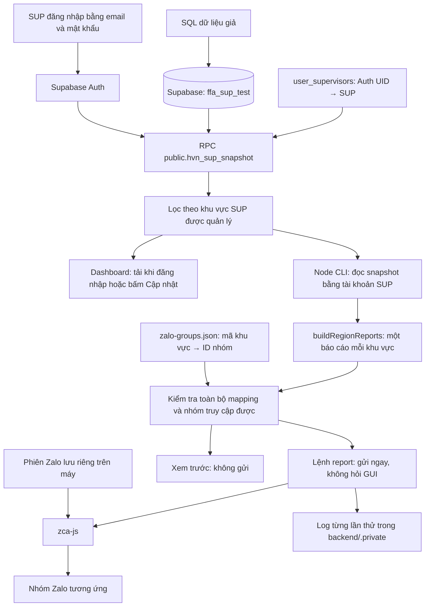
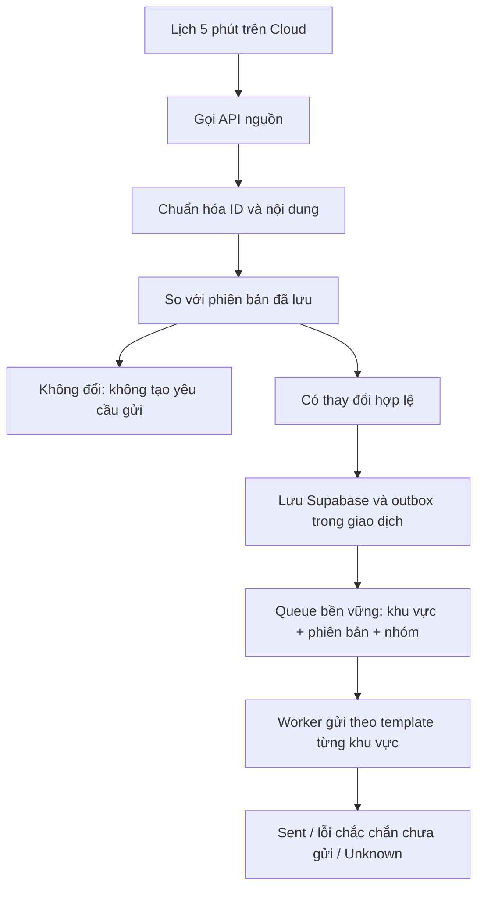

# HVN MER — Hướng dẫn setup, vận hành và chỉnh sửa

Ngày cập nhật: 27/11/2026. Phạm vi: SUP Dashboard → Supabase → báo cáo Zalo theo khu vực.

Tài liệu này ghi lại hệ thống thực tế đã xây trong project, không coi các tính năng dự kiến là đã hoàn thành. Các đường dẫn file bên dưới tính từ thư mục gốc project `HVN_MER_VSCode`.

## 1. Trạng thái hiện tại

| Thành phần | Trạng thái và bằng chứng |
|---|---|
| Dữ liệu giả trong Supabase | Người dùng đã chạy SQL; kết quả hai khu vực đúng số liệu mẫu |
| SUP đăng nhập và đọc Supabase | Người dùng xác nhận bằng ảnh Dashboard, 56/115 Store và 49% |
| Zalo cá nhân gửi text | Người dùng cung cấp ảnh tin POC đã nhận |
| Template báo cáo SUP theo khu vực | Đã có code và kiểm thử mô phỏng |
| Nhóm nhận cố định theo khu vực | Đã có cấu hình và kiểm tra mapping trước khi gửi |
| Lệnh xem trước theo mapping | Người dùng xác nhận chạy thành công sau khi dùng Node trực tiếp |
| Gửi thật theo template và mapping mới | Có lệnh; chưa có ảnh/kết quả xác nhận riêng trong cuộc trao đổi |
| Bộ kiểm thử cục bộ | Lần kiểm tra gần nhất: 18 test PASS; không thay thế kiểm thử dịch vụ thật |
| Vercel | Người dùng đã có bản public; chưa xác nhận bản đó đã deploy các thay đổi mới nhất |
| API nguồn, chu kỳ 5 phút, phát hiện thay đổi | Chưa triển khai |
| Backend Cloud chạy khi máy cá nhân tắt | Chưa triển khai |

## 2. Sơ đồ luồng thực tế



Dashboard và CLI độc lập. Đóng Dashboard không ảnh hưởng một lệnh CLI đang chạy. Tuy nhiên, hiện chưa có tiến trình chạy định kỳ: đóng Terminal hoặc tắt máy thì không có tác vụ tự động tiếp tục.

Database test dùng schema riêng. Chỉ RPC trong `public` được frontend gọi; không cần đưa `ffa_sup_test` vào danh sách schema công khai của Data API.

## 3. Cấu trúc và vị trí sửa nhanh

| Muốn thay đổi | File / vị trí |
|---|---|
| URL, Publishable key, chế độ demo/Supabase | `supabase-config.js` |
| Đăng nhập Auth, gọi RPC, thông báo lỗi API | `supabase-data.js` |
| Giao diện và KPI SUP | `app.js`: `renderSupDashboard`, `renderSupMetrics`, `aggregate` |
| Template copy/xem trước trên giao diện | `app.js`: `createSupReportText` |
| Template và cách tổng hợp tin gửi bằng Node | `backend/sup-report.mjs`: `buildRegionReports` |
| Đọc Supabase từ Node | `backend/sup-report.mjs`: `readSupSnapshot` |
| Nhóm nhận của từng khu vực | `backend/zalo-groups.json` |
| Kiểm tra mapping | `backend/group-routing.mjs`: `buildDeliveryPlan` |
| Các lệnh login, groups, preview, report | `backend/zalo-poc.mjs` và `backend/package.json` |
| Gửi một lần thử và ghi kết quả | `backend/send-once.mjs` |
| Tài khoản SUP cho CLI | `backend/.env`, chỉ lưu riêng trên máy |
| Phiên Zalo | `backend/.private/session.json`, không chia sẻ |
| Nguồn sinh dữ liệu demo | `mock-data.js` |
| Sinh SQL fixture | `database/generate-sup-fixture.cjs` |
| Tạo/nạp fixture | `database/sup-test-fixture.sql` |
| RPC và quyền đọc | `database/sup-api.sql` |
| Bảo vệ file khỏi Git / bản deploy frontend | `.gitignore` / `.vercelignore` |

**Template frontend và backend hiện nằm ở hai nơi.** Khi muốn hai đầu có cùng nội dung, sửa cả `createSupReportText` và `buildRegionReports`, rồi đối chiếu. View SQL KPI không phải nguồn trực tiếp mà code gửi tin hiện đọc; CLI lấy snapshot và tổng hợp bằng JavaScript.

## 4. Setup từ một bản project mới

### 4.1. Công cụ

Mở project bằng VS Code. Trong Terminal kiểm tra:

```powershell
node -v
npm -v
git --version
```

Backend khai báo Node >=22; máy đã kiểm tra có Node 22.15.0. Dùng Live Server hoặc máy chủ HTTP tĩnh để chạy frontend. Không cần chuyển project sang Next.js.

### 4.2. Supabase test

1. Tạo project test, bật Data API.
2. SQL Editor → New query → chạy toàn bộ `database/sup-test-fixture.sql`.
3. Query mới → chạy toàn bộ `database/sup-api.sql`.
4. Authentication → Users → tạo một tài khoản SUP. Xác nhận email hoặc dùng Auto Confirm trong môi trường test.
5. Copy Auth User UID và chạy đoạn sau, thay UUID mẫu bằng UID thật:

```sql
insert into ffa_sup_test.user_supervisors (user_id, supervisor_id)
values ('YOUR-AUTH-USER-UUID'::uuid, 'SUP-001')
on conflict (user_id) do update
set supervisor_id = excluded.supervisor_id;

select user_id, supervisor_id
from ffa_sup_test.user_supervisors;
```

Kết quả: tài khoản được nối với `SUP-001`. Không truyền SUP ID tùy ý từ frontend để quyết định quyền. RPC lấy danh tính từ `auth.uid()` và kiểm tra mapping phía database.

Các bảng fixture: `regions`, `employees`, `supervisors`, `stores`, `reports`, `check_ins`; bảng quyền: `user_supervisors`. SQL bật RLS; RPC dùng SECURITY DEFINER với search_path rỗng và kiểm tra quyền tường minh. Không cấp quyền sửa bảng cho trình duyệt.

### 4.3. Cấu hình frontend

Điền Project URL và Publishable key vào `supabase-config.js`:

```js
window.HvnConfig = {
  mode: 'supabase',
  supabaseUrl: 'https://YOUR-PROJECT.supabase.co',
  publishableKey: 'sb_publishable_YOUR_PUBLIC_KEY'
};
```

Đây là cấu hình công khai. Không dùng service_role, secret key hoặc database password. Biến môi trường trên Vercel không tự thay nội dung file JS tĩnh này.

Mở `index.html` bằng Live Server → đăng nhập SUP → chọn 27/11/2026 và Tất cả khu vực. Nút **Cập nhật dữ liệu** tải lại snapshot. Chưa tự realtime/polling; tải lại trang cần đăng nhập lại. Phiên đăng nhập frontend chưa tự refresh.

### 4.4. Backend và tài khoản đọc dữ liệu

Từ root project:

```powershell
cd backend
npm install --ignore-scripts
```

Nếu đã có package-lock hợp lệ và cần cài lại đúng phiên bản: `npm ci --ignore-scripts`.

Copy `backend/.env.example` thành `backend/.env` nếu chưa có; không ghi đè file cấu hình đang dùng. Điền riêng trên máy:

```dotenv
SUPABASE_EMAIL=your-sup-email@example.com
SUPABASE_PASSWORD="your-password"
```

Dùng cùng tài khoản SUP đã được gán quyền. Không đưa mật khẩu vào chat hoặc Git. Backend đọc URL/key từ `supabase-config.js`, tái sử dụng adapter Auth/RPC của frontend; sau khi lấy snapshot, adapter logout phiên Auth tạo bởi CLI.

### 4.5. Đăng nhập Zalo một lần

Trong Terminal tại `backend`:

```powershell
npm run zalo:login
```

Mở ảnh `backend/.private/login-qr.png` trực tiếp trên máy, dùng Zalo điện thoại quét và xác nhận. Thành công sẽ lưu `session.json`; lệnh sau khôi phục phiên từ file này. Hết phiên cần chạy login lại. Không gửi ảnh QR, cookie hoặc session cho người khác.

`zca-js` 2.4.0 là thư viện không chính thức. Tài khoản có thể bị hạn chế/khóa; POC gửi được không bảo đảm ổn định dài hạn. Dùng tài khoản test và nhóm đồng ý nhận tin. Tham khảo [repository thư viện](https://github.com/RFS-ADRENO/zca-js).

### 4.6. Cố định nhóm theo khu vực

```powershell
npm run zalo:groups
```

Copy ID thật, điền `backend/zalo-groups.json`:

```json
{
  "hn": { "groupId": "ID_NHOM_HA_NOI" },
  "ct": { "groupId": "ID_NHOM_CAN_THO" }
}
```

ID phải là chuỗi số trong dấu nháy kép, không phải số thứ tự hoặc tên nhóm. Các giá trị trên chỉ là chỗ điền. Có thể dùng chung một ID cho hai khu vực khi test; vẫn nhận hai tin. Đổi nhóm chỉ sửa file này, không sửa database.

Chương trình kiểm tra tất cả mapping trước khi gửi tin đầu tiên. Thiếu ID hoặc không đọc được nhóm sẽ dừng, không tự chọn nhóm khác. Đọc được nhóm không bảo đảm tài khoản luôn có quyền gửi: quyền có thể thay đổi sau bước kiểm tra.

## 5. Lệnh vận hành hằng lần

**Các lệnh sau chạy tại thư mục `backend`. Ưu tiên gọi Node trực tiếp vì máy người dùng đã gặp npm làm mất cờ `--date`.**

Chỉ xem nội dung và nhóm đích, không gửi:

```powershell
node --env-file-if-exists=.env zalo-poc.mjs report --preview --date 2026-11-27
```

Gửi ngay theo mapping, không hỏi chọn nhóm hoặc xác nhận GUI:

```powershell
node --env-file-if-exists=.env zalo-poc.mjs report --date 2026-11-27
```

Nếu bỏ `--date`, ngày mặc định là ngày hiện tại theo `Asia/Ho_Chi_Minh`. Fixture hiện có cần chọn đúng 2026-11-27. Lệnh `npm run zalo:test` vẫn là tin kiểm tra kết nối tương tác, không phải template báo cáo.

Mỗi lần chạy lệnh report là một lượt gửi mới, kể cả dữ liệu không đổi. Chưa có chống gửi lại cùng snapshot giữa các lần chạy. Không đặt cron lặp lệnh này và coi như đã có cơ chế chỉ gửi khi cập nhật.

## 6. Template và số liệu đối chiếu

Mỗi khu vực một tin. Ví dụ Hà Nội:

```text
Báo cáo cuối ngày

Ngày: 27/11/2026

Team Sup: Nguyễn Xuân Toàn

Khu vực: Hà Nội

Nhân viên ra thị trường: 10

Số Store đã trưng bày / Số Target: 30/53

Số báo cáo đã nhận / Total PLAN: 30/53
```

| Phạm vi | Nhân sự hoạt động/quản lý | Store hoàn thành/PLAN | Báo cáo | Tỷ lệ Dashboard |
|---|---|---|---|---|
| Hà Nội | 10/12 | 30/53 | 30/53 | 57% |
| Cần Thơ | 11/14 | 26/62 | 26/62 | 42% |
| Toàn bộ | 21/26 | 56/115 | 56/115 | 49% |

Đây là kết quả fixture chưa sửa. Dữ liệu gồm 2 khu vực, 26 MER, 1 SUP, 115 Store, 56 báo cáo ngày mẫu và 7 báo cáo lịch sử, 63 check-in.

Quy tắc hiện có:

- Lọc báo cáo theo `date` và cửa hàng thuộc khu vực.
- Nhân sự hoạt động: số nhân viên duy nhất có báo cáo hoặc check-in tại các cửa hàng đó trong ngày.
- Target: tổng `stores.target`; hoàn thành: tổng target của các cửa hàng có báo cáo.
- Báo cáo đã nhận: đếm trạng thái `submitted`, không dùng `Completed`.
- Total PLAN của số báo cáo: số cửa hàng được giao. Chưa có kế hoạch viếng thăm riêng từng ngày.
- Ngày chưa có báo cáo vẫn có PLAN tĩnh và một tin tổng hợp 0 cho mỗi khu vực.
- Template hiện chưa chứa chi tiết trưng bày/tồn kho. Sửa các chi tiết đó có thể không đổi tin tổng hợp.

## 7. Chỉnh dữ liệu và xác minh thay đổi

Trong SQL Editor của project test:

```sql
update ffa_sup_test.reports
set display = jsonb_set(display, '{glass}', '9'::jsonb),
    notes = 'TEST: cập nhật từ Supabase'
where id = 'SAMPLE-HN-001';
```

Dashboard → Cập nhật dữ liệu → mở báo cáo HN-001 ngày 27/11/2026, kiểm tra Mặt kính = 9. Thay đổi này không làm tăng số Store hoàn thành và không hiện trong template tổng hợp hiện tại. Hoàn nguyên:

```sql
update ffa_sup_test.reports
set display = jsonb_set(display, '{glass}', '1'::jsonb),
    notes = 'Trưng bày gọn, đủ nhận diện thương hiệu.'
where id = 'SAMPLE-HN-001';
```

Muốn thêm khu vực: thêm `regions`, nhân viên, cửa hàng, báo cáo liên quan trong database; cập nhật `supervisors.regionIds`; thêm mapping nhóm theo ID khu vực mới; chạy preview. Thêm mapping JSON đơn lẻ không tự tạo dữ liệu hay cấp quyền khu vực.

Muốn sinh fixture cho ngày khác, chạy từ root `node database/generate-sup-fixture.cjs YYYY-MM-DD`, sau đó kiểm tra SQL trước khi áp dụng lên fixture mới. Seed dùng ID ổn định và bỏ qua bản ghi đã tồn tại: chạy lại không đổi ngày hoặc reset dữ liệu cũ. Không xóa schema đang dùng tùy tiện.

## 8. Log và xử lý lỗi

| Hiện tượng | Kiểm tra / cách xử lý |
|---|---|
| Không đúng tham số, log npm mất `--date` | Dùng lệnh Node trực tiếp ở mục 5 |
| Chưa có phiên Zalo | Chạy `npm run zalo:login` |
| Không khôi phục được phiên | Kiểm tra mạng; đăng nhập QR lại nếu phiên không còn hợp lệ |
| SUP đăng nhập được nhưng RPC từ chối | Kiểm tra `user_supervisors` và RPC đã chạy từ `sup-api.sql` |
| Thiếu SUPABASE_EMAIL/PASSWORD | Sửa `backend/.env`, chạy tại `backend`; không in mật khẩu ra log |
| Chưa cấu hình groupId | Điền đúng chuỗi ID trong `zalo-groups.json` |
| Không truy cập được nhóm | Kiểm tra ID, tài khoản thành viên và quyền nhóm; không có fallback |
| Ngày trả 0 | Kiểm tra `reports.date`, ngày lệnh và phạm vi SUP |
| Tin test ngắn thay vì báo cáo | Đang dùng `zalo:test`; dùng lệnh `report` |
| Preview xong chưa có tin | Bình thường: preview không gửi |
| Backend chạy local nhưng Vercel chưa đổi | Vercel cần deploy code frontend mới; không tự chạy backend Zalo |

Mỗi lần thử gửi tạo file `backend/.private/HVN-....json`. File lưu mã lần thử, nhóm, thời điểm và trạng thái; không chứa cookie/session.

- `Sent`: gateway trả message ID và log lưu được; chưa chứng minh người nhận đã đọc.
- `Unknown`: lỗi sau khi chuẩn bị gửi hoặc không có ID xác nhận. Kiểm tra nhóm và thời điểm trước khi chạy lại; không tự retry.
- Log được đặt trước khi gọi gateway; cùng đường dẫn lần thử không dispatch hai lần. Đây không phải chống trùng giữa hai lần chạy mới vì mỗi lần tạo UUID mới.
- Gửi tuần tự: tin khu vực thứ nhất có thể thành công rồi tin thứ hai lỗi. Không có rollback tin Zalo; kiểm tra trước khi chạy lại toàn bộ.

## 9. Git, Vercel và dữ liệu riêng

- Đưa source, SQL, template, test và cấu hình nhóm phù hợp quyền truy cập repo vào Git; không đưa `.env`, QR hoặc session vào Git.
- `.gitignore` bỏ qua `.env`, `node_modules`, `backend/.private`. Với file đã được track từ trước, ignore không tự gỡ file khỏi lịch sử Git.
- `.vercelignore` loại `backend`, `database`, `tests`, `.env` và thư mục riêng khỏi bản deploy frontend. Khi dùng cách hosting khác phải kiểm tra loại trừ tương đương.
- Không public thư mục gốc chứa backend qua một máy chủ tĩnh truy cập Internet; Live Server chỉ dùng cho test local.
- Sửa frontend/config công khai cần deploy Vercel lại. Sửa SQL phải chạy riêng trong Supabase; push Git không tự chạy SQL.
- Sửa backend/group mapping cần cập nhật nơi chạy backend. Vercel frontend không lưu giữ phiên Zalo hoặc chạy worker liên tục.

## 10. Kiểm thử sau mỗi chỉnh sửa

Từ root project:

```powershell
node --check backend/zalo-poc.mjs
node --test backend/test/*.test.mjs tests/supabase-data.test.cjs tests/sup-cloud-app.test.cjs
```

Checklist thực tế: đăng nhập SUP → chọn đúng ngày → đối chiếu KPI → preview đúng nhóm và mỗi khu vực một tin → chủ động chạy report một lần → đối chiếu điện thoại và log. Chỉ đánh dấu gửi thật PASS khi đã quan sát tin thực tế, không dựa riêng vào test mô phỏng hoặc preview.

## 11. Luồng mục tiêu tiếp theo: mỗi 5 phút, chỉ gửi khi thay đổi

**Phần này là thiết kế tiếp theo, chưa có trong code hiện tại.**



Các quyết định cần giữ rõ trước khi làm:

1. Lần đầu đồng bộ làm mốc, không tự gửi toàn bộ lịch sử, trừ khi có quyết định gửi bù.
2. Xác định thay đổi bằng nội dung nghiệp vụ, không chỉ thời điểm đồng bộ.
3. Chốt cách xử lý chi tiết thay đổi nhưng tin tổng hợp không đổi: vẫn gửi lại tổng hợp, bổ sung chi tiết, hay chỉ gửi khi số liệu tổng hợp đổi. Chưa áp dụng chính sách nào trong code.
4. Queue/outbox phải bền vững, có khóa phiên bản và claim nguyên tử; không dùng UUID mỗi lần chạy làm khóa chống trùng nghiệp vụ.
5. Retry có giới hạn cho lỗi chắc chắn chưa gửi; Unknown cần đối soát. Không hứa exactly-once qua gateway không hỗ trợ idempotency.
6. Phân biệt độ trễ lấy nguồn (0–5 phút thông thường) với thời gian xử lý/gửi sau đó; API lỗi hoặc chậm có thể làm lâu hơn.
7. Chạy đồng bộ và gateway trên backend Cloud liên tục, bảo vệ phiên/secrets, có pause và cảnh báo; test khi máy cá nhân tắt.

## 12. Thông tin bàn giao cho người tiếp tục

Repo: [badept/HVNMERSUMMARYREPORT](https://github.com/badept/HVNMERSUMMARYREPORT). Không giả định remote hoặc deployment đã đồng bộ với local.

Khi tiếp tục, đọc tài liệu này, AGENTS.md và source liên quan. Không đọc hoặc yêu cầu đưa `.env`, session vào chat. Giữ riêng việc sửa source, chạy SQL và deploy. Dùng kết quả thực tế để cập nhật trạng thái; không coi mô tả kế hoạch là bằng chứng hoàn thành.

Mẫu ghi kết quả:

```text
Ngày / phiên bản:
Thay đổi:
Môi trường: local / Supabase test / Vercel / Cloud backend
Ngày dữ liệu:
Khu vực và nhóm nhận (ẩn khi chia sẻ ra ngoài):
Preview: PASS / FAIL / NOT RUN
Gửi thật và đối chiếu điện thoại: PASS / FAIL / NOT RUN
Test tự động:
Lỗi hoặc giới hạn:
Bước tiếp theo:
```
